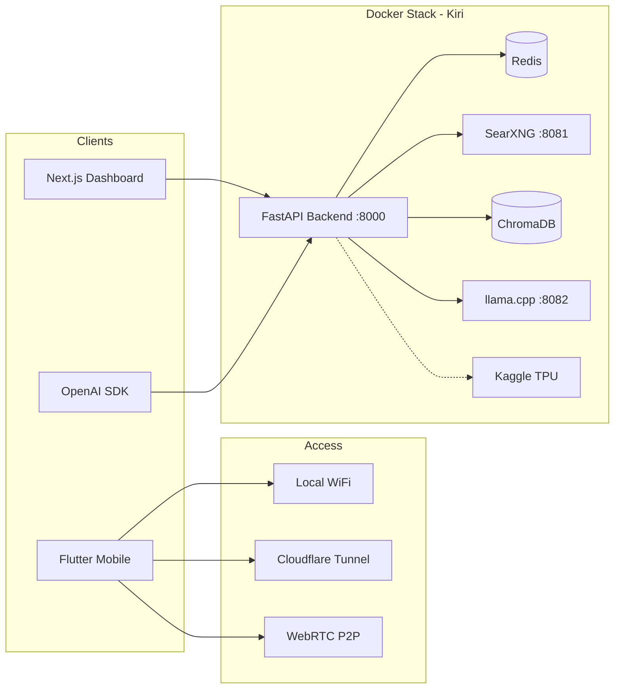

# 🧠 Brain Container OS

**Privacy-first local AI platform** — RAG, plugins, and chat in your own container. No cloud dependency. No data leaves your machine (unless you choose a remote provider).

[](LICENSE)
[](docker/docker-compose.yml)
[](apps/mobile)
[](apps/dashboard)

---

## ✨ Features

- **Local RAG** — Upload documents, chunk, embed, and retrieve with ChromaDB
- **Plugin System** — Sandboxed Python plugins (calculator, web search, file browser)
- **Multi-Provider LLM** — llama.cpp (local), DeepSeek, OpenAI-compatible, Kaggle TPU
- **Web Dashboard** — Next.js 14 with dark theme, chat playground, system monitoring
- **Mobile Client** — Flutter app with streaming chat, offline queue, P2P WebRTC
- **OpenAI-Compatible API** — Drop-in replacement for OpenAI API at `/v1/chat/completions`
- **Privacy-First** — All data stays in your container by default

---

## 🏗️ Architecture



---

## 📁 Monorepo Structure

```
brain-container/
├── apps/
│   ├── backend/          # FastAPI + RAG + Plugins + WebSocket
│   ├── dashboard/        # Next.js 14 web dashboard
│   └── mobile/           # Flutter client
├── packages/
│   ├── shared-types/     # TypeScript types
│   ├── plugin-sdk/       # Python SDK for plugins
│   └── ui/               # Shared React components
├── docker/               # docker-compose.yml + Dockerfiles
├── .github/workflows/    # CI/CD pipelines
├── website/              # Docusaurus docs
└── apps/kaggle-tpu/      # TPU inference server
```

---

## 🚀 Quick Start (5 minutes)

### Prerequisites
- Docker + Docker Compose (Kiri recommended)
- Node.js 20+ & pnpm 9
- Python 3.11+
- Flutter 3.24+ (for mobile)

### 1. Clone & Install
```bash
git clone https://github.com/your-org/brain-container.git
cd brain-container
pnpm install
```

### 2. Start Backend
```bash
cd apps/backend
python -m venv .venv && source .venv/bin/activate
pip install -r requirements.txt
export API_KEY=dev-key
uvicorn app.main:app --reload --port 8000
```

### 3. Start Dashboard
```bash
pnpm --filter @brain-container/dashboard dev
# Open http://localhost:3000
```

### 4. Full Stack (Docker)
```bash
cd docker
export API_KEY=dev-key
docker compose up -d --build
# Backend: http://localhost:8000
# Dashboard: http://localhost:3000
# SearXNG: http://localhost:8081
```

---

## 🔑 Environment Variables

| Variable | Default | Description |
|----------|---------|-------------|
| `API_KEY` | `change-me` | Backend API key (X-API-Key header) |
| `LLM_PROVIDER` | `tpu` | Provider: llamacpp, deepseek, openai_compatible, tpu |
| `LLM_BASE_URL` | `http://llamacpp:8080/v1` | llama.cpp server URL |
| `LLM_MODEL` | `qwen3-14b` | Model name for llama.cpp |
| `DEEPSEEK_API_KEY` | `` | DeepSeek API key |
| `TPU_BASE_URL` | `` | Kaggle TPU server URL |
| `TPU_MODEL` | `gemma-2-9b-it` | TPU model name |
| `CHROMA_PERSIST_DIR` | `/data/chroma` | ChromaDB storage path |

---

## 📡 API Reference

### Core Endpoints
| Method | Path | Description |
|--------|------|-------------|
| GET | `/health` | Health check + provider status |
| GET | `/plugins` | List installed plugins |
| POST | `/plugins/{name}/run` | Execute a plugin |
| POST | `/ingest` | Upload & ingest document (multipart) |
| POST | `/query` | RAG query with tool calling |
| WS | `/chat/stream` | WebSocket streaming chat |
| GET | `/providers` | List available LLM providers |

### OpenAI-Compatible
| Method | Path | Description |
|--------|------|-------------|
| POST | `/v1/chat/completions` | Chat completions (RAG-enhanced) |
| GET | `/v1/models` | List models |

### WebRTC P2P
| Method | Path | Description |
|--------|------|-------------|
| GET | `/webrtc/config` | STUN server list |
| WS | `/webrtc/signal/{id}` | Signaling for P2P |
| GET | `/webrtc/status` | Active sessions |

### TPU
| Method | Path | Description |
|--------|------|-------------|
| POST | `/tpu/connect` | Test TPU connection |

---

## 🔌 Plugin Development

Plugins are Python classes with a `run` method:

```python
from plugin_sdk import Plugin, PluginContext

class MyPlugin(Plugin):
    name = "my_plugin"
    description = "Does something useful"

    def run(self, payload: dict, ctx: PluginContext) -> dict:
        return {"result": f"Hello, {payload.get('name', 'world')}!"}
```

Built-in plugins: `web_search`, `calculator`, `python_executor` (disabled), `file_browser`.

---

## 📱 Mobile App

### Setup
```bash
cd apps/mobile
flutter pub get
flutter run
```

### Features
- Chat with streaming markdown
- Document upload with offline queue (Hive)
- Voice input (Whistle STT — TODO)
- QR code pairing
- Cloudflare Tunnel support
- WebRTC P2P with tunnel fallback

### Pairing
1. Open app → "Connect to Brain Container"
2. Enter backend URL + API key, or scan QR code
3. QR encodes: `{"backend_url": "https://xxx.trycloudflare.com", "api_key": "xxx"}`

---

## 🌐 Remote Access (Cloudflare Tunnel)

```bash
# 1. Start backend locally
# 2. Create tunnel
cloudflared tunnel --url http://localhost:8000
# 3. Copy the generated URL
# 4. Enter in Flutter app or dashboard
```

---

## 🤖 Kaggle TPU Inference

1. Create Kaggle notebook, enable TPU accelerator
2. Upload `apps/kaggle-tpu/` folder
3. Run notebook cells (model auto-downloads from HuggingFace)
4. Copy ngrok URL
5. Set in Brain Container: `LLM_PROVIDER=tpu TPU_BASE_URL=<url> TPU_MODEL=<model>`

Supported models: Gemma-2-9B, Llama-3.1-8B, Mistral-7B

---

## 🔒 Security

- All API endpoints require `X-API-Key` header
- Plugin sandboxing: no network except SearXNG, no filesystem except `/data`
- Use strong `API_KEY` in production
- Dashboard behind basic auth (configure in reverse proxy)
- Secrets: use `sops` + `age` for `.env` encryption

---

## 🧪 Testing

```bash
# Backend
cd apps/backend && pytest

# Dashboard
pnpm --filter @brain-container/dashboard typecheck
pnpm --filter @brain-container/dashboard lint
pnpm --filter @brain-container/dashboard build

# Mobile
cd apps/mobile && flutter test

# Docker
cd docker && docker compose config  # validate compose
```

---

## 📦 Deployment

### Docker (recommended)
```bash
cd docker
export API_KEY=your-secret-key
docker compose up -d --build
```

### Vercel (Dashboard)
```bash
cd apps/dashboard
vercel deploy
```

### GitHub Actions
Push a tag `v1.0.0` to trigger:
- Multi-arch Docker image → GHCR
- Flutter APK → GitHub Release
- Website deploy → Vercel

---

## 🤝 Contributing

1. Fork the repository
2. Create a feature branch
3. Run tests: `pnpm test && flutter test`
4. Submit a PR with clear description

## Code of Conduct
Be respectful and constructive. See [CODE_OF_CONDUCT.md](CODE_OF_CONDUCT.md).

## License
MIT — see [LICENSE](LICENSE).

---

## 📊 Status

| Component | Status |
|-----------|--------|
| Backend API | ✅ Working |
| RAG (ChromaDB) | ✅ Working |
| Plugins | ✅ Working |
| OpenAI API | ✅ Working |
| WebSocket Stream | ✅ Working |
| WebRTC P2P | ✅ Signaling ready |
| Dashboard | ✅ All pages |
| Flutter App | ✅ Core features |
| Kaggle TPU | ✅ Ready |
| CI/CD | ✅ Workflows defined |
